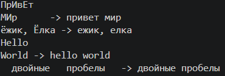
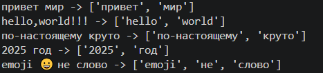
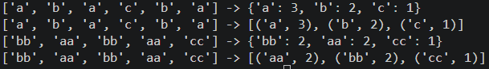
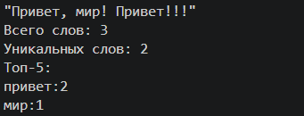
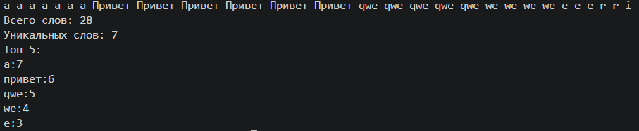

# ЛР3 — Тексты и частоты слов (словарь/множество)

## Задание А
### Реализовал функции normalize, tokenize, count_freq, top_n
Функция normalize:
```python
def normalize(text: str, *, casefold: bool = True, yo2e: bool = True) -> str:
    if casefold: text = text.casefold()
    else: text = text.lower()

    if yo2e: text = text.replace('ё','е')

    text = text.split()
    ans = ' '.join(text)
    return ans
```
Пример работы:



Функция tokenize:
```python
def tokenize(text: str) -> list[str]:
    import re
    znaki = r'\w+(?:-\w+)*'
    ans = re.findall(znaki, text)
    return ans
```
Пример работы:



Функция count_freq:
```python
def count_freq(tokens: list[str]) -> dict[str, int]:
    d = {}
    for i in tokens: d[i] = d.get(i,0) +1
    return d
```

Функция top_n:
```python
def top_n(freq: dict[str, int], n: int = 5) -> list[tuple[str, int]]:
    # freq = count_freq(freq)
    # for i in range(len(freq)):
    #     if freq.get(i) == freq.get(i+1):
    #         return sorted(freq.items())
    #     else: 
    #         return len(freq)              #уничтожить, функцию реализовал ужасно
    items = freq.items()
    ans = sorted(items, key = lambda p: (-p[1], p[0]))
    return ans[:n]
```
Пример работы:



## Задание B
### Скрипт читает одну строку текста из stdin, после чего вызывает функции из библиотеки library/text.py и печатает количество всех слов, количество уникальных слов и топ-5 слов по количеству в порядке убывания в виде "слово:количество"
```python
import sys 
'''"python -m src.lab03.exB" (ввести в терминал,
    а потом через Ctrl+Z и Enter закончить(если винда, если нет, то Ctrl+D))'''

from src.library.text import *

text = sys.stdin.readline() #mb should use input??
if text.strip() == "": raise ValueError("Введена пустая строка.")
norm_text = normalize(text)
token = tokenize(norm_text)
freq = count_freq(token)

N = sum(freq.values()) #or i could use 'len(token)' instead
K = len(set(token)) #or i could use 'len(freq)' instead
a = top_n(freq, n=5)

print(f"Всего слов: {N}")
print(f'Уникальных слов: {K}')
print('Топ-5:')
for w, c in a:
    print(f'{w}:{c}')
```
Пример работы:


