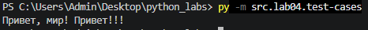
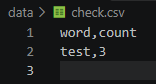
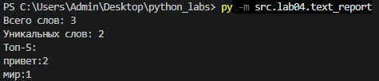
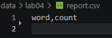
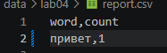

# ЛР4 — Файлы: TXT/CSV и отчёты по текстовой статистике

## Задание А
### Реализовал функции read_text, write_csv
Функция read_text:
```python
def read_text(path: str | Path, encoding: str = "utf-8") -> str:
    '''Читает текстовый файл и возвращает его содержимое (как одну строку).
    По умолчанию используется кодировка'utf-8'.
    Если исходный файл сохранен в другой кодировке, укажите нужную явно
    (например, encoding="cp1251").
    '''
    p = Path(path)
    return p.read_text(encoding=encoding)
```
Пример работы:



Функция write_csv:
```python
def write_csv(rows: Iterable[Sequence], path: str | Path, header: tuple[str, ...] | None = None) -> None:
    '''Создает или перезаписывает CSV-файл с разделителем-запятой.
    Если передан header, он записывается в файл первой строкой.
    При передаче пустого набора rows и наличии header файл будет содержать
    только строку заголовка; если header=None и rows пуст, создается пустой файл.
    Если строки внутри rows имеют разную длину или количество элементов
    в строках не совпадает с длиной заголовка header, то ValueError.
    '''
    p = Path(path)
    rows = list(rows)
    if rows:
        first_len = len(rows[0])
        if header is not None and len(header) != first_len:
            raise ValueError("Длина header не совпадает с количеством колонок в rows")
        for r in rows:
            if len(r) != first_len:
                raise ValueError("Несовпадение длины строк. Все строки в rows должны иметь одинаковую длину")
    with p.open("w", newline="", encoding="utf-8") as f:
        w = csv.writer(f)
        if header is not None:
            w.writerow(header)
        for r in rows:
            w.writerow(r)
    return None
```
Пример работы:



## Задание B
### Скрипт читает один входной файл (путь к входному файлу по умолчанию захардкожен (data/lab04/input.txt), текст читается в кодировке utf-8. При отсутствии файла программа завершается с кодом 1 и выводом ошибки в консоль». Нормализует текст (lib/text.py), токенизирует и считает частоты слов. Посл сохраняет data/report.csv c колонками: word,count, отсортированными: count ↓, слово ↑ (при равенстве).В консоль печатает краткое резюме:
####     "Всего слов:
####     Уникальных слов:
####     Топ-5:

```python
from src.library.text import normalize, tokenize, count_freq, top_n
from src.lab04.io_txt_csv import read_text, write_csv
import sys
try:
    reading_text = read_text('data/lab04/input.txt')
except FileNotFoundError:
    print('Файл не существует')
    sys.exit(1)
    
normalized_text = normalize(reading_text)
tokenized_text = tokenize(normalized_text)
counted_text = count_freq(tokenized_text)
top_ned_text = top_n(counted_text, n=5)

sorted_rows = sorted(counted_text.items(), key = lambda p: (-p[1], p[0]))
write_csv(sorted_rows, 'data/lab04/report.csv', header= ('word', 'count'))

N = len(tokenized_text)
K = len(set(tokenized_text))

print(f'Всего слов: {N}\nУникальных слов: {K}\nТоп-5:')
for w, c in top_ned_text:
    print(f'{w}:{c}')
```
Один файл (база)



Пустой файл



Кодировка cp1251

