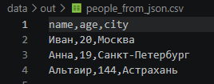
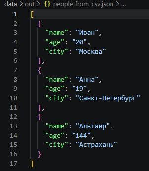

# ЛР5 — JSON и конвертации (JSON↔CSV, CSV→XLSX)

## Задание А — JSON ↔ CSV

Реализовал модуль `src/lab05/json_csv.py` с чистыми функциями `json_to_csv` и `csv_to_json`.
Функции не производят вывод в `stdout`, работают строго с кодировкой UTF-8 и валидируют входные данные.

### Функция json_to_csv:

```python
def json_to_csv(json_path: str, csv_path: str) -> None:
    """
    Преобразует JSON-файл в CSV.
    Поддерживает список словарей [{...}, {...}], заполняет отсутствующие поля пустыми строками.
    Кодировка UTF-8. Порядок колонок — как в первом объекте или алфавитный (указано в README).
    Если неверный тип файла, пустой JSON или CSV, то возвращается ValueError.
    Если файл отсутствует, то возвращается FileNotFoundError.
    """
    p_in = Path(json_path)
    p_out = Path(csv_path)

    if not p_in.exists() or not p_in.is_file():
        raise FileNotFoundError(f"Файл не найден: {json_path}")

    try:
        with p_in.open("r", encoding="utf-8") as f:
            data = json.load(f)
    except json.JSONDecodeError:
        raise ValueError(f"Некорректный JSON-файл:{json_path}")
    if (not isinstance(data, list) or len(data) == 0 or not all(isinstance(row, dict) for row in data)):
        raise ValueError("Пустой JSON или неподдерживаемая структура")

    fieldnames: list[str] = []
    for row in data:
        for key in row.keys():
            if key not in fieldnames:
                fieldnames.append(key)

    Path(csv_path).parent.mkdir(parents=True, exist_ok=True)

    with p_out.open("w", encoding="utf-8", newline="") as f:
        writer = csv.DictWriter(f, fieldnames=fieldnames, restval="")
        writer.writeheader()
        writer.writerows(data)
    return None
```
### Пример работы:


### Функция csv_to_json:

```python
def csv_to_json(csv_path: str, json_path: str) -> None:
    """
    Преобразует CSV в JSON (список словарей).
    Заголовок обязателен, значения сохраняются как строки.
    json.dump(..., ensure_ascii=False, indent=2)
    Если неверный тип файла, пустой JSON или CSV, то возвращается ValueError.
    Если файл отсутствует, то возвращается FileNotFoundError.
    """
    p_in = Path(csv_path)
    p_out = Path(json_path)

    if not p_in.exists() or not p_in.is_file():
        raise FileNotFoundError(f"Файл не найден: {csv_path}")

    with p_in.open("r", encoding="utf-8", newline="") as f:
        reader = csv.DictReader(f)
        if reader.fieldnames is None:
            raise ValueError("CSV без заголовка или пуст")

        rows = list(reader)

    if not rows:
        raise ValueError("CSV без заголовка или пуст")

    Path(csv_path).parent.mkdir(parents=True, exist_ok=True)

    with p_out.open("w", encoding="utf-8") as f:
        json.dump(rows, f, ensure_ascii=False, indent=2)
    return None

if __name__ == "__main__":
    #демо запуск конвертаций по тз
    json_to_csv("data/samples/people.json", "data/out/people_from_json.csv")
    csv_to_json("data/samples/people.csv", "data/out/people_from_csv.json")
    print("Конвертации JSON <-> CSV успешно выполнены.")
```

### Пример работы:


## Задание B — CSV → XLSX

Реализовал модуль src/lab05/csv_xlsx.py с функцией csv_to_xlsx, использующей библиотеку openpyxl (зафиксирована в requirements.txt).

### Функция csv_to_xlsx:

```python
def csv_to_xlsx(csv_path: str, xlsx_path: str) -> None:
    """
    Конвертирует CSV в XLSX.
    Использует openpyxl.
    Первая строка CSV — заголовок.
    Лист называется "Sheet1".
    Колонки — автоширина по длине текста (не менее 8 символов).
    Если неверный тип файла, пустой JSON или CSV, то возвращается ValueError.
    Если файл отсутствует, то возвращается FileNotFoundError' 
    """
    p_in = Path(csv_path)
    p_out = Path(xlsx_path)

    if not p_in.exists() or not p_in.is_file():
        raise FileNotFoundError(f"Файл не найден: {csv_path}")

    with p_in.open("r", encoding="utf-8", newline="") as f:
        reader = csv.reader(f)
        rows = list(reader)

    if not rows:
        raise ValueError("CSV пуст или не содержит строк")

    wb = Workbook()
    ws = wb.active
    ws.title = "Sheet1"

    for row in rows:
        ws.append(row)

    #need автоширина по длине текста
    for col in ws.columns:
        max_len = max(len(str(cell.value or "")) for cell in col)
        col_letter = col[0].column_letter
        ws.column_dimensions[col_letter].width = max(max_len + 3, 8)


    Path(csv_path).parent.mkdir(parents=True, exist_ok=True)
    wb.save(p_out)


if __name__ == "__main__":
    csv_to_xlsx("data/samples/people.csv", "data/out/people.xlsx")
    csv_to_xlsx("data/samples/cities.csv", "data/out/cities.xlsx")
    print("Конвертация CSV -> XLSX успешно выполнена.")
```

### Пример работы:


## Краевые случаи и валидация
### В соответствии с требованиями ТЗ обработаны следующие исключительные ситуации:
Файл отсутствует: выбрасывается FileNotFoundError (не перехватывается молча, пути проверяются через exists()). 
Пустой входной JSON / не список словарей: выбрасывается ValueError("Пустой JSON или неподдерживаемая структура"). 
Битый JSON-файл: ошибка парсинга json.JSONDecodeError перехватывается и оборачивается в понятный ValueError. 
Пустой CSV или файл без заголовков: выбрасывается ValueError("CSV без заголовка или пустой"). 