# ЛР6 — CLI‑утилиты с argparse (cat/grep‑lite + конвертеры): Техническое задание
## Задание cli_text
Содержит подкоманды stats, cat

### Подкоманда cat выводит содержимое текстового файла построчно. Для нумерации строк используется флаг -n.
Параметры:
--input — обязательный путь к входному файлу;
-n — необязательный флаг нумерации строк.

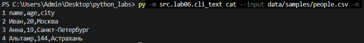

### Подкоманда stats подсчитывает частоты слов в текстовом файле. Для обработки используются функции из src/library/text.py:
normalize() — нормализация текста;
tokenize() — выделение слов;
count_freq() — подсчёт частот;
top_n() — сортировка и выбор наиболее частых слов.

Параметры:
--input — обязательный путь к текстовому файлу;
--top — количество слов в результате (по дефолту 5).

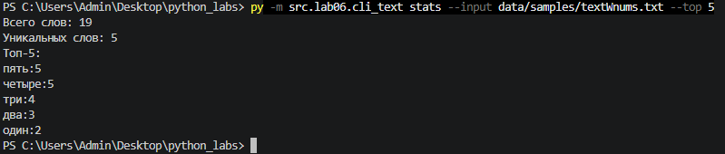

### --help
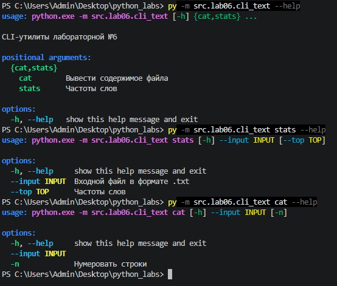

## Задание cli_convert
Содержит подкоманды json2csv, csv2json, csv2xlsx
### Что вводилось в терминал:
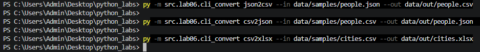
### Подкоманда json2csv преобразует JSON в CSV
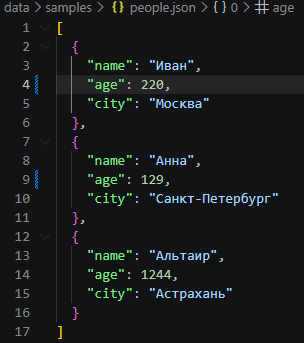
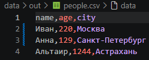

### Подкоманда csv2json преобразует CSV в JSON
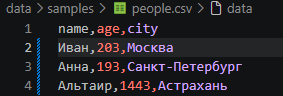
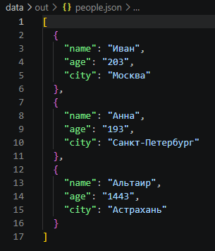

### Подкоманда csv2xlsx преобразует CSV в XLSX
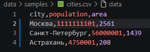
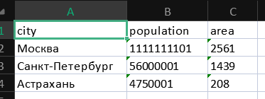
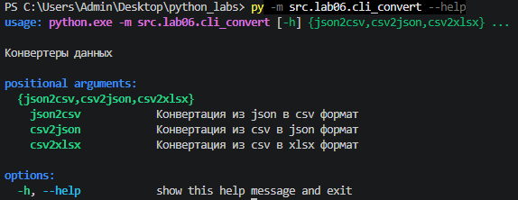