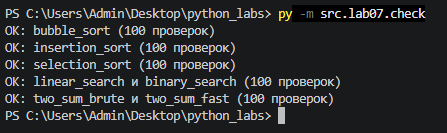

# ЛР7 — Поиск, сортировка и измерение времени

## Задание A — Поиск (`src/lab07/search.py`)

- **`linear_search(nums, x) -> int`** — последовательный проход слева направо, возвращает индекс первого вхождения `x` или `-1`. Предварительная сортировка не нужна. Сложность: время O(n), дополнительная память O(1).
- **`binary_search(sorted_nums, x) -> int`** — поиск в отсортированном по возрастанию списке через границы `lo`, `hi` и середину `mid = (lo + hi) // 2` с условием цикла `while lo <= hi`. Возвращает индекс любого вхождения `x` или `-1`; на неотсортированном списке результат не определён. Сложность: время O(\log n), дополнительная память O(1).
- **`two_sum_brute(nums, target) -> tuple[int, int] | None`** — двойной цикл по индексам `(i, j)` с условием `i < j` (внутренний цикл начинается с `i + 1`). Возвращает пару индексов с суммой `target` или `None`. Сложность: время O(n^2), дополнительная память O(1).
- **`two_sum_fast(nums, target) -> tuple[int, int] | None`** — один проход со словарём `seen` («значение → индекс»). Для элемента `x` сначала проверяется наличие `target - x` в `seen`, и только после этого записывается `seen[x] = i`. Это исключает повторное использование одного индекса и гарантирует `i < j`. Сложность: время O(n) в среднем, дополнительная память O(n).

## Задание B — Сортировки (`src/lab07/sorting.py`)

Все три функции сортируют список по возрастанию без использования `sorted`, `.sort()`, `min` и `max`. Каждая функция начинает работу с копии `work = list(nums)`, поэтому исходный список не изменяется, а дополнительная память составляет O(n). Корректно обрабатываются пустой список, список из одного элемента и дубликаты.

- **`bubble_sort(nums) -> list`** — сравнивает и меняет местами соседние элементы. На каждом проходе максимум перемещается в конец, поэтому правая граница внутреннего цикла сдвигается на `i`. Реализован флаг раннего выхода `was_swapped`: если за проход обменов не было, цикл прерывается через `break`. Время: O(n^2) в худшем и среднем случае, O(n) на уже отсортированном списке.
- **`insertion_sort(nums) -> list`** — расширяет отсортированную левую часть, сдвигая большие элементы вправо и вставляя текущий элемент `key` на освободившуюся позицию. Время: O(n^2) в худшем случае, O(n) на уже отсортированных данных.
- **`selection_sort(nums) -> list`** — на каждом шаге ищет индекс минимума в неотсортированном хвосте и ставит его на текущую позицию `i`. Время: всегда O(n^2), даже на отсортированном списке.

## Задание C — Проверка против эталона (`src/lab07/check.py`)

Для воспроизводимости зафиксирован `random.seed(42)`. Реализованы три проверки:

- **`check_sorting(fn, trials=100)`** — генерирует случайные списки длиной от `0` до `50` с числами от `-100` до `100` (включая повторы и отрицательные значения), сверяет результат с `sorted(nums)` и проверяет неизменность исходного списка.
- **`check_search(trials=100)`** — сверяет `linear_search` с `list.index` (и `-1` при `ValueError`), а `binary_search` проверяет на отсортированных списках: для отсутствующего элемента ожидается `-1`, для случайного и крайних элементов (`sorted_nums[0]`, `sorted_nums[-1]`) проверяется условие `bin_idx != -1 and sorted_nums[bin_idx] == x`.
- **`check_two_sum(trials=100)`** — проверяет, что `two_sum_brute` и `two_sum_fast` согласованно возвращают либо оба `None`, либо допустимые пары с `0 <= i < j < len(nums)` и суммой `target`.

Запуск:

```powershell
py -m src.lab07.check
```

Результат (500 случайных проверок):

```text
OK: bubble_sort (100 проверок)
OK: insertion_sort (100 проверок)
OK: selection_sort (100 проверок)
OK: linear_search и binary_search (100 проверок)
OK: two_sum_brute и two_sum_fast (100 проверок)
```



## Задание D — Бенчмарк (`src/lab07/bench.py`)

Все данные генерируются заранее с `random.seed(42)`, внутри каждой задачи алгоритмы получают одинаковые входные списки. Время измеряется через `timeit.repeat` с выбором минимума `min(times) / number`: для быстрых функций выполняется серия повторов, чтобы отсечь системный шум, для квадратичных сортировок на n = 100\,000 выставлено ограничение `> 60 с`. В задаче Two Sum два последних элемента задаются уникальной парой (`1_000_000` и `1_000_001`), чтобы `two_sum_brute` не завершался досрочно на случайном совпадении в начале списка.

Запуск:

```powershell
py -m src.lab07.bench
```

Результаты сохраняются функцией `write_csv` из ЛР4 в файл `data/lab07/bench.csv` (колонки `task,n,impl,seconds`):

| task | n | impl | seconds |
| --- | ---: | --- | ---: |
| sort | 1000 | sorted | 0.000043 |
| sort | 1000 | bubble_sort | 0.026073 |
| sort | 1000 | insertion_sort | 0.011986 |
| sort | 1000 | selection_sort | 0.011941 |
| sort | 10000 | sorted | 0.000831 |
| sort | 10000 | bubble_sort | 2.938399 |
| sort | 10000 | insertion_sort | 1.301889 |
| sort | 10000 | selection_sort | 1.152664 |
| sort | 100000 | sorted | 0.011576 |
| sort | 100000 | bubble_sort | > 60 с |
| sort | 100000 | insertion_sort | > 60 с |
| sort | 100000 | selection_sort | > 60 с |
| search | 100000 | sorting | 0.011609 |
| search | 100000 | linear_search | 20.808699 |
| search | 100000 | binary_search | 0.013109 |
| two_sum | 1000 | two_sum_brute | 0.015021 |
| two_sum | 1000 | two_sum_fast | 0.000078 |
| two_sum | 10000 | two_sum_brute | 1.535196 |
| two_sum | 10000 | two_sum_fast | 0.001001 |


## Выводы

Сортировки пузырьком, вставками и выбором имеют квадратичную сложность O(n^2): два вложенных цикла выполняют порядка n^2 / 2 сравнений. Когда длина списка увеличивается в 10 раз (с 10^3 до 10^4), число шагов вырастает примерно в 10^2 = 100 раз — на замерах `bubble_sort` замедлилась в ~113 раз (с `0.026073` с до `2.938399` с), `insertion_sort` в ~109 раз, `selection_sort` в ~97 раз, а при n = 10^5 все три алгоритма выходят за предел 60 секунд. Встроенная функция `sorted` использует алгоритм Timsort со сложностью O(n \log n): при переходе с 10^4 на 10^5 логарифмический множитель растёт слабо (с \approx 13{,}3 до \approx 16{,}6), поэтому время увеличилось примерно в 13,9 раза (с `0.000831` с до `0.011576` с). Та же разница порядков видна в задаче Two Sum: перебор пар за O(n^2) замедлился в ~102 раза (с `0.015021` с до `1.535196` с), а решение со словарём за O(n) — примерно в 12,8 раза (с `0.000078` с до `0.001001` с).

Бинарный поиск на каждом шаге отбрасывает половину отрезка на основании сравнения с серединой, поэтому на неотсортированном списке он молча выдаёт неверный ответ. Для единичных запросов предварительная сортировка невыгодна: один вызов `sorted` на списке из 10^5 чисел занял `0.011609` с, тогда как один линейный проход занимает в среднем `0.0021` с. Уже с 6-го запроса затраты на сортировку полностью окупаются, и на 10^4 запросов связка `sorting + binary_search` (`0.024718` с суммарно) обгоняет `linear_search` (`20.808699` с) более чем в 840 раз. Модуль `check.py` выполнил 500 случайных проверок (по 100 прогонов на каждую сортировку, пару алгоритмов поиска и оба решения Two Sum), включая крайние и отсутствующие элементы, а также проверку неизменности исходного списка; после исправления границ циклов, сдвигов в бинарном поиске и раннего выхода пузырька на этапе отладки все 500 прогонов завершились статусом `OK` без расхождений с эталонами.