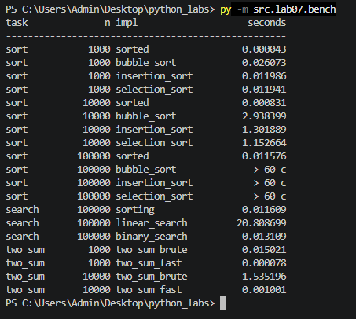

# ЛР7 — Поиск, сортировка и измерение времени

## Реализованные модули

- `src/lab07/search.py` — `linear_search`, `binary_search`, `two_sum_brute`, `two_sum_fast`.
- `src/lab07/sorting.py` — `bubble_sort` (с ранним выходом при отсутствии обменов), `insertion_sort`, `selection_sort`. Все функции возвращают новый список и не изменяют исходный.
- `src/lab07/check.py` — автоматическая проверка алгоритмов против встроенных эталонов (`sorted`, `list.index`, взаимная сверка `two_sum`) на случайных данных.
- `src/lab07/bench.py` — замеры времени через `timeit.repeat` (`random.seed(42)`), вывод таблицы в консоль и сохранение в `data/lab07/bench.csv`.

## Результаты бенчмарка

Данные из `data/lab07/bench.csv` (команда запуска: `py -m src.lab07.bench`):

| task | n | impl | seconds |
| --- | ---: | --- | ---: |
| sort | 1000 | sorted | 0.000043 |
| sort | 1000 | bubble_sort | 0.026073 |
| sort | 1000 | insertion_sort | 0.011986 |
| sort | 1000 | selection_sort | 0.011941 |
| sort | 10000 | sorted | 0.000831 |
| sort | 10000 | bubble_sort | 2.938399 |
| sort | 10000 | insertion_sort | 1.301889 |
| sort | 10000 | selection_sort | 1.152664 |
| sort | 100000 | sorted | 0.011576 |
| sort | 100000 | bubble_sort | > 60 с |
| sort | 100000 | insertion_sort | > 60 с |
| sort | 100000 | selection_sort | > 60 с |
| search | 100000 | sorting | 0.011609 |
| search | 100000 | linear_search | 20.808699 |
| search | 100000 | binary_search | 0.013109 |
| two_sum | 1000 | two_sum_brute | 0.015021 |
| two_sum | 1000 | two_sum_fast | 0.000078 |
| two_sum | 10000 | two_sum_brute | 1.535196 |
| two_sum | 10000 | two_sum_fast | 0.001001 |



## Проверка против эталона (`check.py`)

Запуск командой `py -m src.lab07.check`:

```text
OK: bubble_sort (100 проверок)
OK: insertion_sort (100 проверок)
OK: selection_sort (100 проверок)
OK: linear_search и binary_search (100 проверок)
OK: two_sum_brute и two_sum_fast (100 проверок)
```


## Выводы

Сортировка пузырьком, вставками и выбором имеют квадратичную сложность O(n^2): два вложенных цикла выполняют порядка n^2 / 2 сравнений. Когда длина списка увеличивается в 10 раз (с 10^3 до 10^4), число шагов вырастает в 10^2 = 100 раз — в замерах `bubble_sort` замедлилась в ~113 раз (с `0.026073` с до `2.938399` с), `insertion_sort` в ~109 раз, `selection_sort` в ~97 раз, а при n = 10^5 все три алгоритма выходят за предел 60